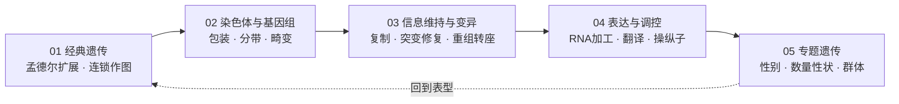

# 遗传学 · 复习总览

> [!abstract] 全书只有一条主线
> **性状如何传递、如何变异、如何在群体中改变**：
> **经典遗传（01）→ 染色体与基因组（02）→ 信息维持与变异（03）→ 表达与调控（04）→ 专题遗传（05）**。
> 复习时先定位环节，再进入对应笔记查细节。

---

## 一、笔记库结构

```
遗传学/
├── 00-复习总览.md                       ← 你在这里
├── 01-经典遗传学/
│   ├── 01-绪论与孟德尔遗传扩展.md        ← 学科史 + 孟德尔比例的修饰 + 代谢病案例
│   └── 02-连锁遗传与染色体作图.md        ← 连锁交换 + 真核三点作图 + 原核作图
├── 02-染色体与基因组/
│   ├── 01-染色体结构与基因组组织.md      ← 各类染色体 + 包装 + 序列组织
│   └── 02-染色体畸变与核型分析.md        ← 分带/核型 + 数目畸变 + 结构畸变
├── 03-遗传信息的维持与变异/
│   ├── 01-DNA复制.md
│   ├── 02-基因突变与修复.md
│   └── 03-重组与转座.md                 ← 同源重组 + 位点特异重组 + 转座
├── 04-基因表达与调控/
│   ├── 01-RNA加工与翻译.md              ← 加帽/加尾 + 核糖体 + 翻译 + 修饰
│   └── 02-基因表达调控.md                ← 操纵子 + 转录后调控
└── 05-专题遗传/
    ├── 01-性别决定与剂量补偿.md
    └── 02-数量性状与群体遗传.md          ← 数量性状 + 群体遗传学
```


## 二、学习地图

| 模块 | 中心问题 | 笔记 | 优先级 |
| :--- | :--- | :--- | :---: |
| 01 经典遗传学 | 性状按什么规律传递？基因如何在染色体上定位？ | [[遗传学/01-经典遗传学/01-绪论与孟德尔遗传扩展\|绪论与孟德尔遗传]] · [[遗传学/01-经典遗传学/02-连锁遗传与染色体作图\|连锁与作图]] | ★★★ |
| 02 染色体与基因组 | 遗传信息如何包装、识别与变异？ | [[遗传学/02-染色体与基因组/01-染色体结构与基因组组织\|染色体结构与基因组]] · [[遗传学/02-染色体与基因组/02-染色体畸变与核型分析\|染色体畸变与核型]] | ★★★ |
| 03 信息维持与变异 | DNA 如何复制、出错与重组？ | [[遗传学/03-遗传信息的维持与变异/01-DNA复制\|DNA 复制]] · [[遗传学/03-遗传信息的维持与变异/02-基因突变与修复\|突变与修复]] · [[遗传学/03-遗传信息的维持与变异/03-重组与转座\|重组与转座]] | ★★★ |
| 04 表达与调控 | 信息如何变成蛋白质，又如何被开关？ | [[遗传学/04-基因表达与调控/01-RNA加工与翻译\|RNA 加工与翻译]] · [[遗传学/04-基因表达与调控/02-基因表达调控\|基因表达调控]] | ★★★ |
| 05 专题遗传 | 性别、数量性状与群体如何特殊化？ | [[遗传学/05-专题遗传/01-性别决定与剂量补偿\|性别决定与剂量补偿]] · [[遗传学/05-专题遗传/02-数量性状与群体遗传\|数量性状与群体遗传]] | ★★☆ |

> [!tip] 建议顺序
> 第一轮：**绪论 → 连锁作图 → 染色体结构 → 复制/突变/重组 → 表达与调控**，把「基因→染色体→分子→群体」打通；
> 第二轮：补 **性别决定、数量性状、群体遗传** 三个专题，并与分子生物学相关内容对照复习。



---

## 三、高频考点速查

> [!note] 用法
> 看到考点先自己复述关键词，再点进主笔记核对；重复内容只在一处详讲，其余用链接回指。

### 01 经典遗传学

| 考点 | 主笔记 | 必须说出的关键词 |
| :--- | :--- | :--- |
| 孟德尔比例的修饰 | [[遗传学/01-经典遗传学/01-绪论与孟德尔遗传扩展\|绪论与孟德尔遗传]] | 不完全显性、共显性、复等位、致死、上位 |
| ABO / 孟买血型 | [[遗传学/01-经典遗传学/01-绪论与孟德尔遗传扩展\|绪论与孟德尔遗传]] | $I^A/I^B/i$、H 底物、隐性上位 |
| 顺反测验 | [[遗传学/01-经典遗传学/01-绪论与孟德尔遗传扩展\|绪论与孟德尔遗传]] | 互补群、子代野生型 = 不同基因 |
| 外显率与表现度 | [[遗传学/01-经典遗传学/01-绪论与孟德尔遗传扩展\|绪论与孟德尔遗传]] | 比例 vs 程度、遗传早现 |
| 三点测交与干涉 | [[遗传学/01-经典遗传学/02-连锁遗传与染色体作图\|连锁与作图]] | 亲本最多、双交换最少、$I=1-C$ |
| Hfr 中断杂交 | [[遗传学/01-经典遗传学/02-连锁遗传与染色体作图\|连锁与作图]] | F 因子整合、进入顺序、受体仍 $F^-$ |

### 02 染色体与基因组

| 考点 | 主笔记 | 必须说出的关键词 |
| :--- | :--- | :--- |
| 核小体与四级包装 | [[遗传学/02-染色体与基因组/01-染色体结构与基因组组织\|染色体结构与基因组]] | 147 bp、八聚体、2→11→30→300→700 nm |
| 组蛋白修饰 | [[遗传学/02-染色体与基因组/01-染色体结构与基因组组织\|染色体结构与基因组]] | 乙酰激活、甲基抑制、组蛋白密码 |
| 特殊染色体 | [[遗传学/02-染色体与基因组/01-染色体结构与基因组组织\|染色体结构与基因组]] | 多线（带/间带/胀泡）、灯刷（侧环） |
| 重复序列与 DNA 指纹 | [[遗传学/02-染色体与基因组/01-染色体结构与基因组组织\|染色体结构与基因组]] | 卫星/小卫星/微卫星、STR |
| 染色体分带与核型 | [[遗传学/02-染色体与基因组/02-染色体畸变与核型分析\|染色体畸变与核型]] | Q/G/C/R/T、m-FISH、序号-臂-区-带 |
| 数目畸变 | [[遗传学/02-染色体与基因组/02-染色体畸变与核型分析\|染色体畸变与核型]] | $2n\pm1$、假显性、母方不分离、同源/异源多倍体 |
| 结构畸变 | [[遗传学/02-染色体与基因组/02-染色体畸变与核型分析\|染色体畸变与核型]] | 缺失环、倒位环、联会十字架、半不育 |

### 03 信息维持与变异

| 考点 | 主笔记 | 必须说出的关键词 |
| :--- | :--- | :--- |
| 半保留复制证据 | [[遗传学/03-遗传信息的维持与变异/01-DNA复制\|DNA 复制]] | $^{15}\mathrm{N}/^{14}\mathrm{N}$、$^3\mathrm{H}$ |
| 复制起始与延伸 | [[遗传学/03-遗传信息的维持与变异/01-DNA复制\|DNA 复制]] | DnaA/B/C、SSB、旋转酶、冈崎片段、长号模型 |
| 端粒酶 | [[遗传学/03-遗传信息的维持与变异/01-DNA复制\|DNA 复制]] | TERC 模板 + TERT 逆转录酶 |
| 突变机制 | [[遗传学/03-遗传信息的维持与变异/02-基因突变与修复\|突变与修复]] | 转换/颠换、互变异构、5-BU、EMS、吖啶、T–T 二聚体 |
| DNA 修复 | [[遗传学/03-遗传信息的维持与变异/02-基因突变与修复\|突变与修复]] | BER、NER(UvrABC)、MutS/L/H、SOS |
| 同源重组三模型 | [[遗传学/03-遗传信息的维持与变异/03-重组与转座\|重组与转座]] | Holliday、DSB、RecBCD/$\chi$、RuvABC |
| 转座元件 | [[遗传学/03-遗传信息的维持与变异/03-重组与转座\|重组与转座]] | IS(ITR/DR)、Tn、Ac/Ds、LTR/非 LTR |

### 04 表达与调控

| 考点 | 主笔记 | 必须说出的关键词 |
| :--- | :--- | :--- |
| 5′ 帽与 poly(A) | [[遗传学/04-基因表达与调控/01-RNA加工与翻译\|RNA 加工与翻译]] | m⁷G、Cap 0/1/2、AAUAAA、PAP、APA |
| 核糖体与 tRNA | [[遗传学/04-基因表达与调控/01-RNA加工与翻译\|RNA 加工与翻译]] | 70S/80S、A/P/E、SD、Kozak、aaRS |
| 翻译三阶段 | [[遗传学/04-基因表达与调控/01-RNA加工与翻译\|RNA 加工与翻译]] | IF/eIF、EF-Tu/Ts/G、RF1/2/3 |
| 色氨酸操纵子 | [[遗传学/04-基因表达与调控/02-基因表达调控\|基因表达调控]] | 多顺反子、trpR/P/O、1-2-3-4 发卡、衰减 |
| RNA 沉默 | [[遗传学/04-基因表达与调控/02-基因表达调控\|基因表达调控]] | siRNA、miRNA、Dicer、RISC/RITS |

### 05 专题遗传

| 考点 | 主笔记 | 必须说出的关键词 |
| :--- | :--- | :--- |
| 人类性别决定 | [[遗传学/05-专题遗传/01-性别决定与剂量补偿\|性别决定与剂量补偿]] | SRY→TDF→Sox9、AR、CYP11A |
| 剂量补偿 | [[遗传学/05-专题遗传/01-性别决定与剂量补偿\|性别决定与剂量补偿]] | 巴氏小体、莱昂定律、XIST/TSIX、PAR |
| 果蝇与爬行动物 | [[遗传学/05-专题遗传/01-性别决定与剂量补偿\|性别决定与剂量补偿]] | X:A 比值、Y 定可育、温度三模式 |
| 数量性状 | [[遗传学/05-专题遗传/02-数量性状与群体遗传\|数量性状与群体遗传]] | 多因子假说、$F_2$ 正态、阈值性状 |
| 遗传力 | [[遗传学/05-专题遗传/02-数量性状与群体遗传\|数量性状与群体遗传]] | $V_P/V_G/V_A/V_D/V_I$、广义 vs 狭义 |
| 群体遗传 | [[遗传学/05-专题遗传/02-数量性状与群体遗传\|数量性状与群体遗传]] | 适合度、$\Delta p$、漂变、近交系数、$p+q=1$ |

---
