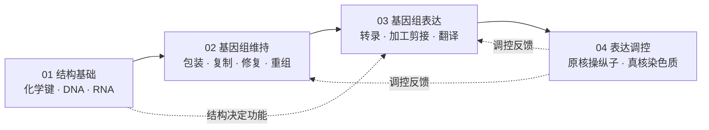

# 分子生物学 · 复习总览

> [!abstract] 全书只有一条主线
> **遗传信息如何被「存好 → 复制好 → 读出来 → 管起来」**：
> **结构（01）→ 维持（02）→ 表达（03）→ 调控（04）**。
> 所有知识点都是这条主线上的某个环节，复习时先定位环节，再记细节。

---

## 一、笔记库结构

```
分子生物学/
├── 00-复习总览.md                     ← 你在这里
├── 01-结构基础/
│   ├── 01-化学键与分子间作用力.md
│   ├── 02-DNA结构与拓扑.md
│   └── 03-RNA结构与功能.md
├── 02-基因组维持/
│   ├── 01-基因组与染色体包装.md
│   ├── 02-DNA复制.md
│   ├── 03-DNA损伤突变与修复.md
│   └── 04-重组与转座.md               ← 同源重组 + 位点特异性重组 + 转座
├── 03-基因组表达/
│   ├── 01-转录.md
│   ├── 02-RNA加工与剪接.md            ← 加帽/加尾 + 剪接 + 编辑
│   └── 03-翻译.md
└── 04-表达调控/
    ├── 01-原核转录调控.md
    └── 02-真核转录调控.md
```


---

## 二、学习地图

| 模块 | 中心问题 | 笔记 | 优先级 |
| :--- | :--- | :--- | :---: |
| 01 结构基础 | 信息载体长什么样？靠什么力维持？ | [[分子生物学/01-结构基础/01-化学键与分子间作用力\|化学键]] · [[分子生物学/01-结构基础/02-DNA结构与拓扑\|DNA 结构与拓扑]] · [[分子生物学/01-结构基础/03-RNA结构与功能\|RNA 结构与功能]] | ★★☆ |
| 02 基因组维持 | 信息如何保持稳定、传递与变异？ | [[分子生物学/02-基因组维持/01-基因组与染色体包装\|基因组与染色体包装]] · [[分子生物学/02-基因组维持/02-DNA复制\|DNA 复制]] · [[分子生物学/02-基因组维持/03-DNA损伤突变与修复\|DNA 损伤突变与修复]] · [[分子生物学/02-基因组维持/04-重组与转座\|重组与转座]] | ★★★ |
| 03 基因组表达 | 信息如何变成 RNA 和蛋白质？ | [[分子生物学/03-基因组表达/01-转录\|转录]] · [[分子生物学/03-基因组表达/02-RNA加工与剪接\|RNA 加工与剪接]] · [[分子生物学/03-基因组表达/03-翻译\|翻译]] | ★★★ |
| 04 表达调控 | 细胞如何决定「何时、何地、表达多少」？ | [[分子生物学/04-表达调控/01-原核转录调控\|原核转录调控]] · [[分子生物学/04-表达调控/02-真核转录调控\|真核转录调控]] | ★★★ |

> [!tip] 建议顺序
> 先按地图走一遍 **结构 → 复制 → 转录 → 翻译 → 调控**，把「遗传信息流向」打通；
> 第二轮再回头补 **修复、重组、转座、染色质** 这些「维护与调控」专题。



---

## 三、高频考点速查

> [!note] 用法
> 看到考点先自己复述关键词，再点进「主笔记」核对。重复内容只在一个主笔记里详讲。

### 01 结构基础

| 考点 | 主笔记 | 必须说出的关键词 |
| :--- | :--- | :--- |
| 强弱化学键类型与意义 | [[分子生物学/01-结构基础/01-化学键与分子间作用力\|化学键]] | 共价/非共价、可逆、方向性、特异性 |
| DNA 结构特征 | [[分子生物学/01-结构基础/02-DNA结构与拓扑\|DNA 结构]] | 反向平行、双螺旋、碱基互补、碱基堆积力 |
| 大沟 / 小沟 | [[分子生物学/01-结构基础/02-DNA结构与拓扑\|DNA 结构]] | 120°/240°、ADAM/AADH、调控 vs 修复复制 |
| B/A/Z-DNA 对照 | [[分子生物学/01-结构基础/02-DNA结构与拓扑\|DNA 结构]] | 手性、每圈 bp、糖环构象、糖苷键 |
| DNA 拓扑与异构酶 | [[分子生物学/01-结构基础/02-DNA结构与拓扑\|DNA 结构]] | Lk = Tw + Wr、负超螺旋、Ⅰ 型/Ⅱ 型 |
| RNA 二级结构 | [[分子生物学/01-结构基础/03-RNA结构与功能\|RNA 结构]] | 茎、发卡、凸起、内环、假结 |
| 假结的功能 | [[分子生物学/01-结构基础/03-RNA结构与功能\|RNA 结构]] | 阻核糖体、催化活性、端粒酶 RNA |

### 02 基因组维持

| 考点 | 主笔记 | 必须说出的关键词 |
| :--- | :--- | :--- |
| 基因组大小 vs 复杂度 | [[分子生物学/02-基因组维持/01-基因组与染色体包装\|基因组与染色体包装]] | 基因密度、内含子、重复序列 |
| 染色体三大元件 | [[分子生物学/02-基因组维持/01-基因组与染色体包装\|基因组与染色体包装]] | 复制起点、着丝粒、端粒 |
| 核小体组成与组蛋白 | [[分子生物学/02-基因组维持/01-基因组与染色体包装\|基因组与染色体包装]] | 147 bp / 1.65 圈、八聚体、H1、小沟 |
| 组蛋白尾巴修饰 | [[分子生物学/02-基因组维持/01-基因组与染色体包装\|基因组与染色体包装]] | 乙酰化/甲基化/磷酸化、组蛋白密码 |
| 聚合酶保真性与结构域 | [[分子生物学/02-基因组维持/02-DNA复制\|DNA 复制]] | 手掌/手指/拇指、几何匹配、动力学校对 |
| 复制叉与滑动夹 | [[分子生物学/02-基因组维持/02-DNA复制\|DNA 复制]] | 前导/后随、冈崎片段、PCNA、长号模型 |
| 复制起始（原核 vs 真核） | [[分子生物学/02-基因组维持/02-DNA复制\|DNA 复制]] | DnaA/oriC、ORC-MCM-CMG、once per cycle |
| 末端复制问题 | [[分子生物学/02-基因组维持/02-DNA复制\|DNA 复制]] | TER/TERT、t 环、蛋白计数模型 |
| 突变类型 | [[分子生物学/02-基因组维持/03-DNA损伤突变与修复\|DNA 损伤突变与修复]] | 转换/颠换、互变异构、移码、无义/错义 |
| 错配修复链识别 | [[分子生物学/02-基因组维持/03-DNA损伤突变与修复\|DNA 损伤突变与修复]] | MutS/L/H、半甲基化 GATC、PCNA |
| 切除修复 | [[分子生物学/02-基因组维持/03-DNA损伤突变与修复\|DNA 损伤突变与修复]] | BER 糖苷酶、NER UvrABC / XPC |
| DSB 修复 | [[分子生物学/02-基因组维持/03-DNA损伤突变与修复\|DNA 损伤突变与修复]] | HR vs NHEJ、跨损伤 TLS |
| Holliday 模型 | [[分子生物学/02-基因组维持/04-重组与转座\|重组与转座]] | 链侵入、分支迁移、连接体拆分 |
| RecBCD / Rad51 | [[分子生物学/02-基因组维持/04-重组与转座\|重组与转座]] | χ 位点、3′ 悬尾、Spo11、MRX |
| 位点特异性重组 vs 转座 | [[分子生物学/02-基因组维持/04-重组与转座\|重组与转座]] | 特异位点、剪切-粘贴、复制转座 |

### 03 基因组表达

| 考点 | 主笔记 | 必须说出的关键词 |
| :--- | :--- | :--- |
| 转录三阶段 | [[分子生物学/03-基因组表达/01-转录\|转录]] | 闭合→开放→逃逸、转录泡、流产性起始 |
| 原核启动子与 σ | [[分子生物学/03-基因组表达/01-转录\|转录]] | -10/-35、UP 元件、σ⁷⁰ 结构域 2/4 |
| 原核终止 | [[分子生物学/03-基因组表达/01-转录\|转录]] | 颈环+连续 U、Rho/rut 位点 |
| 真核 Pol II 与 GTF | [[分子生物学/03-基因组表达/01-转录\|转录]] | TATA/TBP、TFIID→H、PIC、CTD |
| 5′ 帽 / 3′ poly(A) | [[分子生物学/03-基因组表达/02-RNA加工与剪接\|RNA 加工与剪接]] | m⁷G、Cap 0/1/2、AAUAAA、PAP、鱼雷模型 |
| 剪接化学与剪接体 | [[分子生物学/03-基因组表达/02-RNA加工与剪接\|RNA 加工与剪接]] | 两次转酯、套索、U1/U2/U4/U6、U12 |
| 可变剪接与 RNA 编辑 | [[分子生物学/03-基因组表达/02-RNA加工与剪接\|RNA 加工与剪接]] | 外显子跳读/互斥、内含子滞留、C→U/A→I |
| 翻译组分与核糖体位点 | [[分子生物学/03-基因组表达/03-翻译\|翻译]] | mRNA/tRNA/aaRS/核糖体、A/P/E |
| 翻译起始（原核 vs 真核） | [[分子生物学/03-基因组表达/03-翻译\|翻译]] | RBS/SD、fMet、Kozak、扫描、环化 |
| 延长与校对 | [[分子生物学/03-基因组表达/03-翻译\|翻译]] | EF-Tu/Ts/G、16S rRNA 小沟识别 |
| 终止与回收 | [[分子生物学/03-基因组表达/03-翻译\|翻译]] | RF1/2/3、GGQ、RRF、eRF1/Rli1 |
| 遗传密码特点 | [[分子生物学/03-基因组表达/03-翻译\|翻译]] | 简并性、摆动、通用性、非重叠 |

### 04 表达调控

| 考点 | 主笔记 | 必须说出的关键词 |
| :--- | :--- | :--- |
| 为什么调控在转录起始 | [[分子生物学/04-表达调控/01-原核转录调控\|原核转录调控]] | 节能、快速响应 |
| 激活/抑制机制 | [[分子生物学/04-表达调控/01-原核转录调控\|原核转录调控]] | 招募、变构、空间位阻、DNA 成环 |
| 乳糖操纵子 | [[分子生物学/04-表达调控/01-原核转录调控\|原核转录调控]] | LacI/O/P/ZYA、别乳糖、cAMP-CAP |
| 真核调控因子 | [[分子生物学/04-表达调控/02-真核转录调控\|真核转录调控]] | 锌指/亮氨酸拉链/HLH/HMG、激活域 |
| 组合控制与协同 | [[分子生物学/04-表达调控/02-真核转录调控\|真核转录调控]] | 多激活子、位置效应 |
| 基因沉默与表观遗传 | [[分子生物学/04-表达调控/02-真核转录调控\|真核转录调控]] | 异染色质、DNA 甲基化、基因组印记 |

---

## 四、易混淆概念速查

| 容易混 | 核心区别 | 详见 |
| :--- | :--- | :--- |
| **复制 vs 转录** | 模板范围（全基因组 vs 单基因）、原料（dNTP vs NTP）、引物（有 vs 无）、产物结合（紧密 vs 短暂）、准确性（高 vs 低） | [[分子生物学/03-基因组表达/01-转录\|转录]] |
| **转换 vs 颠换** | 嘌呤↔嘌呤／嘧啶↔嘧啶是转换；嘌呤↔嘧啶是颠换 | [[分子生物学/02-基因组维持/03-DNA损伤突变与修复\|DNA 损伤突变与修复]] |
| **突变 vs 损伤** | 突变是**序列永久改变**；损伤是**化学结构异常**，可被修复而不留痕 | [[分子生物学/02-基因组维持/03-DNA损伤突变与修复\|DNA 损伤突变与修复]] |
| **BER vs NER** | BER 切**单个受损碱基**（糖苷酶→AP 位点）；NER 切**一段寡核苷酸**（识别螺旋扭曲） | [[分子生物学/02-基因组维持/03-DNA损伤突变与修复\|DNA 损伤突变与修复]] |
| **HR vs NHEJ** | HR 用同源模板、准确；NHEJ 直接连末端、易出错 | [[分子生物学/02-基因组维持/04-重组与转座\|重组与转座]] |
| **Holliday vs DSB 修复模型** | 前者从**单链缺口**起始，形成**单个** Holliday 连接体；后者从**双链断裂**起始，形成**双** Holliday 连接体 | [[分子生物学/02-基因组维持/04-重组与转座\|重组与转座]] |
| **位点特异性重组 vs 转座** | 前者发生在**两个特定序列**之间；后者是特定元件插入**非特异位点** | [[分子生物学/02-基因组维持/04-重组与转座\|重组与转座]] |
| **σ 因子 vs 通用转录因子** | 原核一个 σ 即可启动；真核需 TFIID/A/B/F/E/H 多因子组装 PIC | [[分子生物学/03-基因组表达/01-转录\|转录]] |
| **阻遏 vs 沉默** | 阻遏多为**可逆、位点特异**；沉默是**位置效应、可遗传**的异染色质状态 | [[分子生物学/04-表达调控/01-原核转录调控\|原核转录调控]] · [[分子生物学/04-表达调控/02-真核转录调控\|真核转录调控]] |
| **Cap 0/1/2** | 0：仅 m⁷G；1：+ 首位核糖 2′-O 甲基；2：+ 第二位核糖 2′-O 甲基 | [[分子生物学/03-基因组表达/02-RNA加工与剪接\|RNA 加工与剪接]] |
| **凸起 vs 内环** | 凸起只有一条链有未配对核苷酸；内环两条链对应位置都有 | [[分子生物学/01-结构基础/03-RNA结构与功能\|RNA 结构]] |
| **剪切-粘贴 vs 复制转座** | 前者在两端各切两条链、转座子被完整切离；后者各切一条链、原位保留并通过复制产生两个拷贝 | [[分子生物学/02-基因组维持/04-重组与转座\|重组与转座]] |

> [!note] 全模块对照的"唯一主表"在下面第五节；各篇只保留主题内部的对照，不再重复整张大表。

---

## 五、原核 / 真核 全模块对照

| 维度 | 原核生物 | 真核生物 |
| :--- | :--- | :--- |
| 基因组 | 环状、单拷贝、基因密度高、操纵子 | 线型、多拷贝、内含子与重复序列多 |
| 染色体包装 | 无核小体，靠拓扑异构酶维持负超螺旋 | 核小体 → 30 nm → 放射环，负超螺旋储于核小体 |
| 复制起点 | 通常一个（oriC） | 每条染色体多个 |
| 复制次数 | 一个周期可多次 | 一个周期仅一次（G1 加载 / S 期激活） |
| 末端复制 | 环状无末端问题 | 端粒酶 + t 环 |
| 主要复制聚合酶 | Pol III（前导 + 后随） | Pol ε（前导）/ Pol δ（后随） |
| RNA 聚合酶 | 一种 + σ 因子 | Pol I / II / III + 通用转录因子 |
| 转录产物 | 常为多顺反子 | 几乎都是单顺反子 |
| 开放复合物 | 自发，无需 ATP | TFIIH 水解 ATP 驱动 |
| mRNA 加工 | 基本无 | 5′ 帽、剪接、3′ poly(A) |
| 翻译起始 | RBS/SD 序列，fMet-tRNA | 5′ 帽扫描 + Kozak，Met-tRNAᵢ |
| 核糖体 | 70S（30S + 50S） | 80S（40S + 60S） |
| 调控特点 | 操纵子、转录起始为主 | 多层、异时空、组合控制、表观遗传 |
| DNA 甲基化功能 | 错配修复的链识别标记、复制起始 | 表观遗传调控（CpG 岛、印记、X 失活） |

