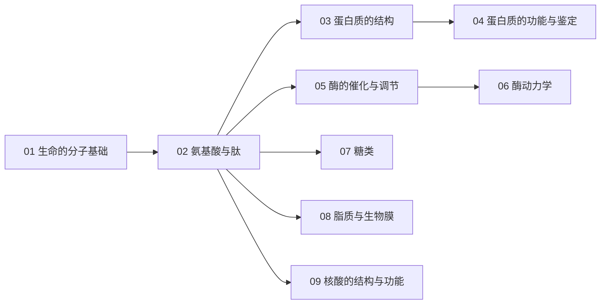

# 生物化学 · 总览与学习路线

## 模块地图

| 笔记 | 核心主题 | 对应原章节 |
| --- | --- | --- |
| [[01-生命的分子基础]] | 生命属性、元素与小分子、构型构象、非共价作用、水与酸碱、细胞概览 | 第一章 + 组学/概念 |
| [[02-氨基酸与肽]] | 氨基酸分类与反应、水解、分离分析、肽的结构与性质 | 第二章前半 + 知识块（氨基酸部分） |
| [[03-蛋白质的结构]] | 组成分类、稳定力、一二三四级结构、折叠变性与结构测定 | 第二章后半 + 第三章 + 知识块（折叠热力学） |
| [[04-蛋白质的功能与鉴定]] | 蛋白功能、肌红/血红蛋白、测序、分离纯化与含量/纯度鉴定 | 第四章 + 第五章 + 第二章（测序与进化） |
| [[05-酶的催化与调节]] | 酶的本质、活性部位、催化机制、别构与共价调节、核酶与酶工程 | 第六章 + 第八章 |
| [[06-酶动力学]] | 化学动力学、米氏方程、作图法、多底物反应、抑制与环境因素 | 第七章 |
| [[07-糖类]] | 单糖、寡糖、多糖、糖缀合物、凝集素与聚糖分析 | 第九章 |
| [[08-脂质与生物膜]] | 脂肪酸、贮存脂质、膜脂、活性脂质、脂蛋白、生物膜与脂质分析 | 第十章 |
| [[09-核酸的结构与功能]] | 碱基/核苷/核苷酸、DNA 各级结构、RNA 结构与功能 | 第十一章 |

## 建议阅读顺序

1. **入门** → 01（分子基础）+ 02（氨基酸与肽）
2. **蛋白质主线** → 03（结构）→ 04（功能与鉴定）
3. **酶学主线** → 05（催化与调节）→ 06（动力学）
4. **其他生物分子** → 07（糖）→ 08（脂质）→ 09（核酸），三者相对独立，可按需选读

